<!-- ═══════════════════════════  YADAVA HC  ═══════════════════════════ -->

<div align="center">

<a href="https://portfolio-yadava-hc.vercel.app">
  
</a>


<br/>

<a href="https://portfolio-yadava-hc.vercel.app"></a>
<a href="https://www.linkedin.com/in/yadava-hc-907067287"></a>
<a href="https://leetcode.com/u/uDbVJTA37J/"></a>
<a href="https://www.geeksforgeeks.org/profile/yadavahc"></a>
<a href="mailto:yadavahc333@gmail.com"></a>


</div>


## `> cat about.yml`

```yaml
name:        Yadava HC
role:        Full Stack Developer · AI Builder · 3× Hackathon Winner
based_in:    Bengaluru, India
studying:    B.E. Information Science @ The Oxford College of Engineering   # CGPA 8.9
builds:      [ Full-Stack Web Apps, AI-Powered Products ]
track_record: "1 national AI award · 6 podium finishes · 3 national finals"
mission:     Make AI useful for the next billion users, in their own language
```


## 🏆 Trophy Cabinet

<div align="center">
  
</div>

<div align="center">

| | Competition | Result |
|:-:|:--|:--|
| 🥇 | **India's First AI Agent Builders Award 2026** | **Winner** · Most Impactful Use Case (with *Arya*) |
| ✨ | **Google Gemini** | **Top Prompt Creator** |
| 🥈 | **OxyHack 2026** | **2nd place** among 500+ participants (with *WattWatch*) |
| 🥈 | **DevKreeda 2026** · Anokha | **2nd place** |
| 🥈 | **InnovateX Ideathon 2024** · BMS College of Engineering | **2nd place** |
| 🥉 | **YC Fall 2026 × Moss Hackathon** | **3rd place** among 300+ participants |
| 🥉 | **CSI Web Hackathon** | **3rd place** |
| 🎯 | **HackBLR 2026** · National Level | **Finalist** (with *Legal Saathi*) |
| 🎯 | **Cypher Quest 2026** · DSATM | **Finalist** |
| 🎯 | **Hackzion** · AMC | **Finalist** |
| 🧩 | **GeeksforGeeks** · TOCE chapter | **Top 30** of 1000+ coders · 100+ DSA problems solved |

</div>


## 🚀 Flagship Builds

<p align="center">
  <a href="https://github.com/yadavahc/Arya-Multilingual-Voice-AI-Healthcare-Assistant"></a>
  <br/>
  <a href="https://github.com/yadavahc/Arya-Multilingual-Voice-AI-Healthcare-Assistant"></a>
</p>

<p align="center">
  <a href="https://github.com/yadavahc/wattwatch"></a>
  <br/>
  <a href="https://wattwatch-lemon.vercel.app"></a>
  <a href="https://github.com/yadavahc/wattwatch"></a>
</p>

<p align="center">
  <a href="https://github.com/yadavahc/Hack-Blr"></a>
  <br/>
  <a href="https://hack-blr-seven.vercel.app"></a>
  <a href="https://github.com/yadavahc/Hack-Blr"></a>
</p>


## ⚡ What I Bring to the Table

<table>
<tr>
<td width="50%" valign="top">

### 🧩 Full-Stack Development
**MongoDB, Express.js, React.js & Node.js** apps with **REST APIs**, plus **Firebase, Supabase & MySQL** when the product needs them.

</td>
<td width="50%" valign="top">

### 🤖 AI Builder
Turns AI into working products: document understanding, smart dashboards and multilingual interfaces, built on solid ML fundamentals.

</td>
</tr>
<tr>
<td valign="top">

### ⏱️ Zero-to-Demo Speed
Takes ideas from a blank repo to a live, judged product inside a hackathon window. That's how **6 podiums and 3 national finals** happened.

</td>
<td valign="top">

### 🚢 Ship & Deploy
Versioned with **Git & GitHub**, containerised with **Docker**, and deployed on **Vercel & Netlify**, end to end.

</td>
</tr>
<tr>
<td valign="top">

### 📊 ML Foundations
Supervised & unsupervised learning, regression to **ANN / CNN**, KNN, Naive Bayes, PCA, and NLP pipelines (**TF-IDF, Word2Vec, NLTK**).

</td>
<td valign="top">

### 🧮 CS Fundamentals
Object-Oriented Programming, Database Management Systems, Operating Systems and Computer Networks.

</td>
</tr>
</table>


## 🛠️ Arsenal

<div align="center">

**Languages**<br/>


**Frontend**<br/>


**Backend & Data**<br/>


**Tools**<br/>


**ML / DL**<br/>


</div>


## 📜 Certifications

<div align="center">


</div>


## 📈 GitHub Pulse

<div align="center">


<picture>
  <source media="(prefers-color-scheme: dark)" srcset="https://raw.githubusercontent.com/yadavahc/yadavahc/output/github-contribution-grid-snake-dark.svg"/>
  <source media="(prefers-color-scheme: light)" srcset="https://raw.githubusercontent.com/yadavahc/yadavahc/output/github-contribution-grid-snake.svg"/>
  
</picture>

</div>


<div align="center">

**Beyond code** · School President (MMVS) · E-Cell TOCE · Youth for Seva volunteer

<br/>


</div>
